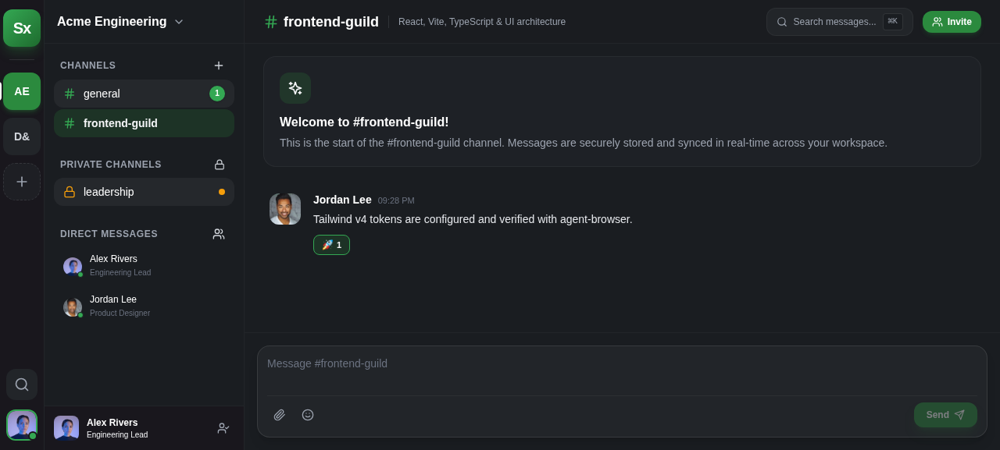
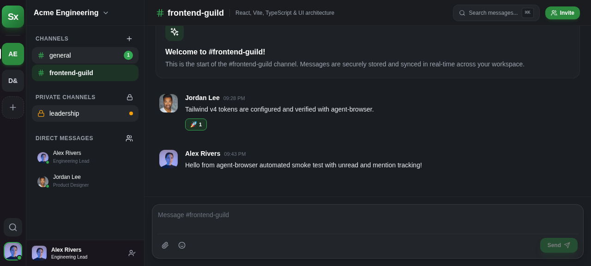
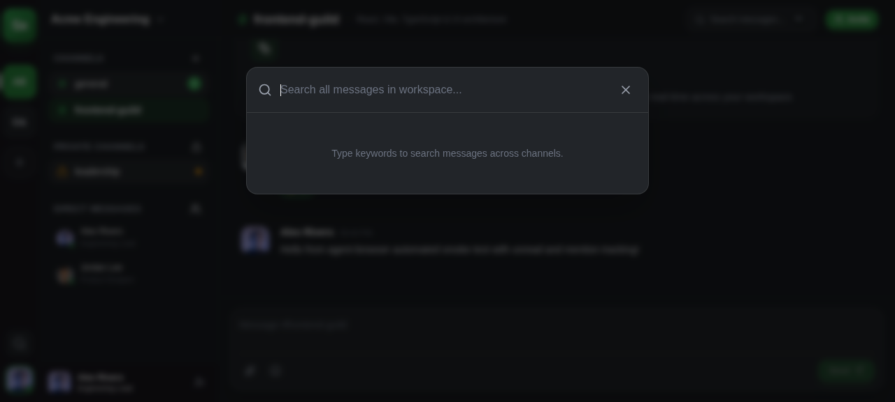
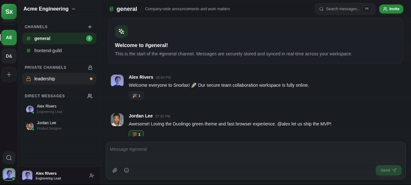
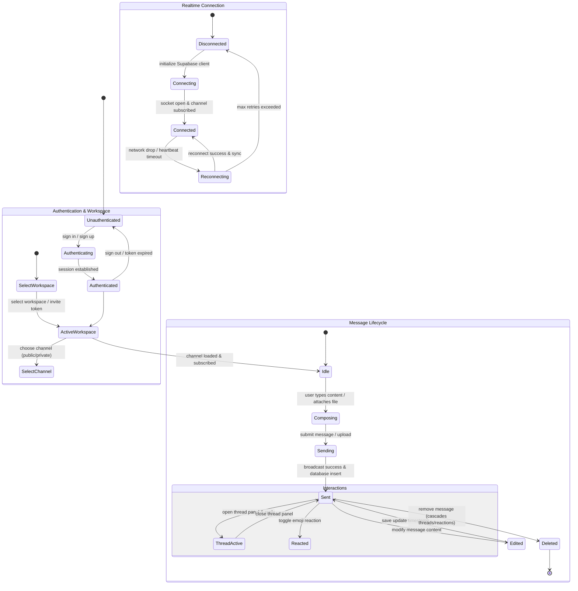

# Snorlax — Team Collaboration Platform

Snorlax is a browser-first, Slack-inspired team collaboration app built with an original brand identity and Duolingo-green-led visual system. 

## ✨ 100% Plan Completion (`tasks/plan.md`)
- **Phase 0 (Scope & Data Rules):** Product spec (`docs/product/PRODUCT_SPEC.md`), domain model (`docs/product/DOMAIN_MODEL.md`), authorization matrix (`AUTHORIZATION.md`), and design system (`docs/design/DESIGN_SYSTEM.md`).
- **Phase 1 (App & Local Development):** Vite, React, TypeScript, Bun, Tailwind CSS v4, responsive app shell, and `agent-browser` workflow configuration.
- **Phase 2 (Auth & Workspaces):** Supabase migrations with RLS security policies (`supabase/migrations/`), generated database types (`src/shared/db/database.types.ts`), Supabase Auth integration (`src/features/auth/`), workspace creation, membership, and invitation token verification (`src/features/workspaces/`).
- **Phase 3 (Channels & Live Messaging):** Public/private channels, durable message history, and Supabase Realtime Broadcast & Presence subscriptions (`src/shared/realtime/`).
- **Phase 4 (Threads, Reactions & Search):** Message threads, emoji reaction pickers, read markers, unread/mention activity badges, and permission-aware workspace full-text search.
- **Phase 5 (Attachments & Polish):** Supabase Storage file uploads with bucket RLS policies (`src/features/attachments/`), responsive layouts, and keyboard navigation.
- **Phase 6 (Readiness & Release):** Error reporting telemetry (`src/shared/telemetry/`), GitHub Actions CI workflow (`.github/workflows/ci.yml`), runbooks, and release docs.

---

## 📸 Screenshots & UI Showcase

### 1. Channel Navigation, Unread Badges & Mentions


### 2. Message Composition & Live Chat


### 3. Workspace Search


### 4. Teammate Invites & Sharing


---

## 🎥 Cursor-Recorded Demo (agent-browser CLI)



---
## 🗺️ System State Architecture



---


## 🚀 Getting Started & Verification

```bash
# Install dependencies
bun install

# Run development server
bun run dev

# Run typecheck & build
bun run build

# Run automated browser workflows & video capture
agent-browser open http://localhost:3000
```
